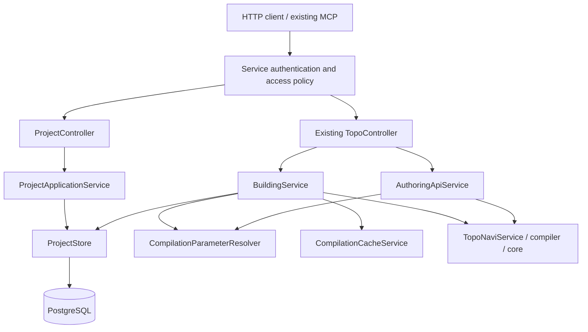

# TopoNavi — Web Architecture Decoupling (Phase 1)

**Technical Specification**

- Version: 0.1
- Date: November 6, 2026
- Status: Proposed implementation design; implementation not started
- Branch: `refactor/web-architecture-decoupling`
- Business requirements: [BRD v0.3](web-architecture-decoupling-phase-1-brd.md)
- Source baseline: `f5eae84` plus the existing working-tree changes to the HTTP guide and topology `graphSequence` contract. These changes are part of the compatibility baseline and must be preserved.

## 1. Outcome and Scope

`toponavi-web` becomes an HTTP adapter for the computation engine plus a generic PostgreSQL-backed TopoScript project store. All persisted building reads use this store. The DSL and core modules continue to consume source strings and compilation parameters without database, authentication, or Spring dependencies.

The work introduces source persistence, replaces runtime filesystem loading, and removes GitHub-backed platform features. It retains the existing building, routing, topology-query, validation, and health HTTP contracts. Replacing platform JWTs with a configured service credential is the explicitly agreed authentication transition.

This specification makes the following implementation choices within the agreed BRD:

| Concern | Phase 1 choice |
|---|---|
| Persisted source of truth | PostgreSQL `projects` and `project_files` in a new dedicated schema |
| Identifiers | Internal project UUID; stable external `buildingId`; separate display name |
| Project update | Full replacement through `PUT`; metadata and files commit together |
| Concurrent writes | Serialize mutations of one project; the last committed replacement wins |
| Compilation validity | Independent of storage validity; empty and non-compiling projects may be saved |
| Building catalog | Preserve configuration-file presence eligibility, exact IDs, sorting, and access filtering |
| Authentication | One configured opaque service Bearer token; no accounts, sessions, or JWT issuance |
| Source import | Explicit local utility calling the authenticated project API |
| Schema evolution | Flyway migrations; Hibernate schema validation only |
| Legacy data | No deletion or conversion; assessment and archival remain deferred |

No new source grammar, route algorithm, editor state format, publication workflow, file-level patch API, history service, or general-purpose storage plugin framework is introduced.

## 2. Current Implementation and Required Changes

| Current code | Current behavior | Change |
|---|---|---|
| [`BuildingService`](../../toponavi-web/src/main/java/com/e611/toponavi/web/service/BuildingService.java) | Scans `platform.examples-path`; reads source files; resolves parameters; compiles and caches | Use the project store for catalog and source snapshots; delegate parameter resolution |
| [`TopoController`](../../toponavi-web/src/main/java/com/e611/toponavi/web/controller/TopoController.java) | Exposes existing building and computation routes | Preserve routes, request rules, response structures, and health behavior |
| [`AuthoringApiService`](../../toponavi-web/src/main/java/com/e611/toponavi/web/service/AuthoringApiService.java) | Validates request-supplied files; depends on `BuildingService` for parameters | Keep the endpoint; use a storage-independent parameter resolver |
| [`CompilationCacheService`](../../toponavi-web/src/main/java/com/e611/toponavi/web/cache/CompilationCacheService.java) | Hashes building ID, file paths/contents, and typed parameters | Retain content-based cache identity; consume the same snapshot used for compilation |
| `map/`, `github/`, legacy entities/repositories | GitHub-backed editor-map CRUD, users, permissions, and versions | Remove runtime code and legacy routes |
| `auth/` | GitHub OAuth, platform JWTs, account lookup, access policy, CORS | Replace authentication; retain explicit anonymous access and CORS policy |
| [`ApiErrors`](../../toponavi-web/src/main/java/com/e611/toponavi/web/api/ApiErrors.java) | Advice is scoped to the `controller` package | Place new `ProjectController` in that package and reuse the common error envelope |
| [`ApiWebConfiguration`](../../toponavi-web/src/main/java/com/e611/toponavi/web/api/ApiWebConfiguration.java) | Rejects query strings on building and authoring routes | Keep that behavior; new project-list pagination is outside those route patterns |
| Docker/Compose and `application-local.yml` | Directory mount; Compose defaults to local H2 memory storage | PostgreSQL deployment with a persistent volume; remove runtime source mount and H2 default |

The compiler already accepts `Map<String, String>` plus `userParams` through `TopoNaviService.compile`. It resolves `configuration.tcfg` before `configuration`, `.tmap`/`.ttr` before extensionless sources, and `root` by its exact key. The new store passes these keys and values unchanged.

## 3. Target Module Boundaries



### 3.1 New or Revised Components

Names below are intended implementation names under `com.e611.toponavi.web`:

| Component | Responsibility |
|---|---|
| `controller.ProjectController` | HTTP project CRUD, request parsing, and response DTOs |
| `project.ProjectApplicationService` | Storage validation and project CRUD orchestration; no compilation prerequisite |
| `project.ProjectStore` | Small internal port for metadata listing, lookup by UUID/building ID, immutable snapshot reads, creation, replacement, and deletion |
| `project.PostgresProjectStore` | Only production store implementation; owns transaction boundaries and translates database failures into internal store errors |
| `project.ProjectEntity`, `ProjectFileEntity`, repositories | JPA mapping, uniqueness, parent-row locks, and file persistence |
| `project.ProjectSnapshot` | Detached metadata plus a defensive, immutable copy of all source strings |
| `project.ProjectStorageValidator` | Identity, filename, source-text, and size validation for persistence |
| `service.CompilationParameterResolver` | Existing `BuildingService.parameters` behavior extracted without semantic changes |
| `auth.ServiceTokenAuthFilter` | Recognize the configured credential and establish a service principal without database lookup |

Keep these components in `toponavi-web`; a new Gradle module is unnecessary for this phase. The project port must not expose JPA entities or lazy collections. Tests may use an in-memory implementation of the port; there is no production filesystem implementation or fallback.

### 3.2 Request Flows

**Stored building computation:** authorize the request; resolve the exact `buildingId`; load one immutable source snapshot; check building eligibility; inspect sources; resolve `userParams`; load or compile the matching cached model; execute existing query/routing logic.

**Project modification:** authenticate the service; parse and validate the complete storage request; perform one project transaction; return only after commit. No compiler call, GitHub request, or filesystem export occurs.

**Generic validation:** authorize using the existing guest-validation policy; inspect and compile the request's `files` with its `userParams`. It does not require the files to be stored or a project UUID. Once the web application is running, this request path must not query PostgreSQL. This does not promise that the whole web application can start without its configured database.

## 4. Data Model and Identity

### 4.1 PostgreSQL Schema

Use a new schema named `toponavi_projects`. Legacy `maps`, users, and permission tables remain outside this schema and are not modified by this phase.

Initial migration: `toponavi-web/src/main/resources/db/migration/V1__create_project_store.sql`.

```sql
CREATE TABLE toponavi_projects.projects (
    id          uuid PRIMARY KEY,
    building_id varchar(255) COLLATE "C" NOT NULL,
    name        varchar(255) NOT NULL,
    created_at  timestamptz NOT NULL,
    updated_at  timestamptz NOT NULL,
    CONSTRAINT projects_building_id_unique UNIQUE (building_id),
    CONSTRAINT projects_building_id_format
        CHECK (building_id ~ '^[A-Za-z0-9][A-Za-z0-9._-]{0,254}$'),
    CONSTRAINT projects_name_nonblank CHECK (length(btrim(name)) > 0)
);

CREATE UNIQUE INDEX projects_building_id_folded_unique
    ON toponavi_projects.projects (lower(building_id));

CREATE TABLE toponavi_projects.project_files (
    project_id uuid NOT NULL
        REFERENCES toponavi_projects.projects(id) ON DELETE CASCADE,
    path       text COLLATE "C" NOT NULL,
    content    text NOT NULL,
    PRIMARY KEY (project_id, path),
    CONSTRAINT project_files_path_length
        CHECK (octet_length(path) BETWEEN 1 AND 512)
);
```

The migration tool creates/manages only the new schema and its schema-history table. Application code generates UUIDs. Timestamps are server-generated UTC instants; clients cannot supply them. Update `updated_at` explicitly for metadata or source replacement, rather than relying on a parent entity becoming dirty when child rows change. Keep Java source contents as database `text`, not large-object OIDs or a compiled-graph JSON column.

### 4.2 Identifier Rules

- `id` identifies the stored project and is used in the new CRUD URLs.
- `buildingId` is mandatory on creation, stable for the project's lifetime, and used in existing building URLs. It cannot be renamed through `PUT` in Phase 1.
- `name` is a nonblank display label of at most 255 characters; changing it does not change the UUID or `buildingId`.
- New IDs follow the ASCII pattern in the schema. The shipped IDs `indigoBJ`, `nbc4`, `swfc`, and `trent` are valid and retain their exact spelling. Native import must preflight every deployed ID; an ID outside this proposed creation policy requires revising the policy before cutover, never silently renaming a deployed building.
- Lookup remains exact and case-sensitive: `swfc` resolves; `SWFC` does not resolve merely because `swfc` exists. Do not add the new creation regex to retained route parameter parsing in a way that changes unknown-building errors.
- Reject case-only duplicates on creation, including concurrent requests. The existing MCP catalog rejects duplicate IDs ignoring case, so accepting both `swfc` and `SWFC` would make its catalog unusable. The folded unique index prevents this while preserving exact lookup and original spelling.
- Deletion frees the identifier. Reusing it creates a new project UUID; no implicit resurrection or history is retained.

`project_files` contains the submitted native source set. No file row is an editor node/edge model, user record, or compiled graph. No foreign keys point to legacy platform tables.

## 5. New Project HTTP API

All routes below require the service credential, even if anonymous building computation is enabled. They are additive to retained `/api/v1/buildings` APIs.

### 5.1 Routes and Responses

| Method | Route | Success | Behavior |
|---|---|---|---|
| POST | `/api/v1/projects` | 201 | Create metadata and the submitted source set; return summary and `Location` header |
| GET | `/api/v1/projects?page=0&size=50` | 200 | Paginated summaries, including incomplete projects; no source contents |
| GET | `/api/v1/projects/{id}` | 200 | Return metadata and the entire current source set |
| GET | `/api/v1/projects/by-building-id/{buildingId}` | 200 | Exact lookup returning the same detail representation, including drafts |
| PUT | `/api/v1/projects/{id}` | 200 | Replace `name` and the entire `files` object atomically; return summary |
| DELETE | `/api/v1/projects/{id}` | 204 | Delete metadata and its source rows in one transaction |

Summary fields: `id`, `buildingId`, `name`, `createdAt`, `updatedAt`. Detail adds `files`, an object from relative path to source string. Single-project success envelopes are `{"status":"success","project":{...}}`.

List responses are `{"status":"success","projects":[...],"page":0,"size":50,"total":4}`. `page` is a nonnegative integer, `size` is 1–200, and results sort by exact `buildingId` ascending. Reject unknown or duplicate query keys. Read the page and count consistently in one read-only transaction. Pagination is not a cross-request snapshot or change feed.

An empty list returns 200. Unknown UUIDs and unknown exact project building IDs return 404 `PROJECT_NOT_FOUND`; malformed UUIDs return 400 `INVALID_REQUEST`. A repeated delete returns 404. UUID lookup never falls back to a similarly named building.

### 5.2 Request Shapes

Create:

```json
{
  "buildingId": "LobbyDemo",
  "name": "Lobby demonstration",
  "files": {
    "configuration": "building-includes {\n submap Lobby\n}\n",
    "Lobby.tmap": "topo-map Lobby() {\n topo-node entrance\n}\n"
  }
}
```

Replace:

```json
{
  "name": "Lobby demonstration",
  "files": {
    "configuration": "building-includes {\n submap Lobby\n}\n",
    "Lobby.tmap": "topo-map Lobby() {\n"
  }
}
```

The unfinished source above is a valid storage request. Both `name` and `files` are required for replacement. Omitting a previously stored path deletes that file; `files: {}` clears the source set. Reject a `buildingId` field on replacement rather than ignoring an attempted rename. There is no PATCH, per-file mutation, compile-on-save, or merge operation in this phase.

### 5.3 Storage Validation

Apply these rules before database mutation:

| Item | Rule |
|---|---|
| JSON envelope | Object; required fields present; no unknown fields; no null values where strings/objects are required |
| `files` | Object of string values; empty object and empty source strings allowed |
| File count | At most 512 by default, configurable |
| Source size | Sum of UTF-8 content bytes at most 4 MiB by default, configurable |
| Path size | 1–512 UTF-8 bytes |
| Paths | Relative POSIX paths; no leading/trailing slash, backslash, empty segment, `.`/`..` segment, control character, or drive/URI prefix |
| Extensions | Basename is extensionless or ends exactly in `.tmap`, `.ttr`, or `.tcfg`; legacy `.json` storage is not accepted |
| Source text | Preserve decoded string content, including line endings, whitespace, and BOM; reject NUL and malformed Unicode that cannot round-trip through PostgreSQL UTF-8 text |
| Duplicate paths | Reject duplicate JSON object keys within the new project endpoints; exact case is significant |

Validate without normalizing, trimming, case-folding, URL-decoding, or flattening filenames. For example, `floor/../Lobby.tmap` is rejected rather than rewritten. Nested paths can be stored, but this adds no compiler support for resolving nested references; the compiler's existing lookup rules remain authoritative. `configuration.tcfg` continues to take precedence over `configuration` if both are present.

Use endpoint-local strict duplicate-key handling and request-size accounting for project mutations. Do not globally change the existing computation JSON parser or impose new filename restrictions on `/authoring/validate`. New project request bodies should have a bounded decoded HTTP size of 32 MiB by default, checked before fully buffering them; source-content limits are still checked after parsing. This allows JSON escaping overhead while bounding metadata and malformed-body allocation. Reject unsupported request content encodings instead of unbounded decompression.

The persisted source limit and existing validation source limit are separate settings with the same defaults. Document that if deployments change them independently, a stored project may exceed the request-supplied validation endpoint's limit.

### 5.4 Error Contract

Use `ApiException`'s existing `{"error":{"code":...,"message":...,"details":...}}` shape. New storage errors do not replace established computation errors.

| Status | Code | Use |
|---|---|---|
| 400 | `INVALID_REQUEST` | Bad envelope, unsupported filename, source-text issue, malformed UUID, invalid pagination; include JSON Pointer `details.path` |
| 401 | `AUTHENTICATION_REQUIRED` | Missing or invalid service authentication on protected routes |
| 403 | `ACCESS_DENIED` | Existing access-denial semantics where applicable |
| 404 | `PROJECT_NOT_FOUND` | New project lookup/mutation target absent |
| 409 | `BUILDING_ID_CONFLICT` | Exact or case-only ID collision; uniqueness must also hold under concurrent create |
| 413 | `PROJECT_TOO_LARGE` | New project HTTP body, file-count, or source-byte limit exceeded; identify the relevant configured limit |
| 503 | `PROJECT_STORE_UNAVAILABLE` | Database/lock-timeout failure on new CRUD APIs |

Catch known constraint violations by constraint identity, rather than treating every database integrity exception as an ID conflict. Do not expose SQL, credentials, or entire source contents in error responses. Extend controller advice for path/query conversion failures if necessary, scoped so existing API errors remain unchanged.

## 6. Transactions, Snapshots, and Cache Correctness

### 6.1 Writes

Create metadata and all files in one transaction. For PUT and DELETE, acquire a pessimistic lock on the parent project row before modifying either metadata or child rows. Validate the submitted replacement before taking the lock, then recheck that the target still exists. Bulk file replacement must flush deletion before inserting paths that reuse the same primary keys; any failure rolls back the complete transaction.

Concurrent replacements of the same project execute serially. The later committed replacement determines the stored state. There is no client version token, optimistic merge, or stale-edit rejection in this phase. This is explicit last-write-wins storage, not collaboration conflict resolution. Concurrent delete/update must yield either a complete update followed by deletion or a not-found update; it must never recreate an absent project or leave orphan files.

Use a finite lock timeout (5 seconds by default) and map timeout/transient storage failure to the boundary-specific 503. Do not automatically replay a mutation after an uncertain commit result. Project creation is not retry-idempotent: after a connection failure, clients can look up the requested `buildingId` before deciding whether to retry.

Write transactions use PostgreSQL's normal `READ COMMITTED` isolation with the parent-row lock. Read snapshots use the separate read-only isolation described below. Apply any database lock-timeout setting transaction-locally so pooled connections do not retain it for unrelated requests.

### 6.2 Reads

Load metadata and files in a short, read-only PostgreSQL `REPEATABLE READ` transaction, then return a detached immutable snapshot and close the transaction before inspection, compilation, cache I/O, or route search. The transaction must start on a Spring-proxied public store method; do not rely on same-class self-invocation to apply the annotation. Disable Open Session in View.

This isolation choice prevents metadata from one committed replacement being combined with files from another when multiple SELECTs are needed. PostgreSQL documents the distinction between per-statement `READ COMMITTED` snapshots and repeatable transaction snapshots in its [transaction isolation reference](https://www.postgresql.org/docs/16/transaction-iso.html).

A request that has obtained its snapshot may finish using it while another request updates or deletes the project. A request starting after the mutation commits must observe the new state or absence. No long-lived database lock is held during computation.

### 6.3 Cache

Keep cache keys based on the exact external `buildingId`, all sorted file paths and exact contents, typed `userParams`, and the existing compiled-format discriminator. Do not substitute `updatedAt`, the UUID alone, or a project-wide latest-result pointer for content identity. One snapshot must supply both cache hashing and compilation inputs.

Authorization and source lookup happen before cache access. Deleted projects and unavailable storage must not be served from old cache entries. Modified invalid sources must report their current failure instead of returning a previous successful model. Old content-addressed cache files may remain as disposable artifacts; deleting a project need not synchronously scan or clear all other projects' caches.

Keep cache read/write failures nonfatal to correct computation where the current service already tolerates them. In-memory/request compilation isolation in `toponavi-dsl` remains unchanged. The filesystem compilation cache is allowed: it is not a source inventory or a replacement for database persistence.

## 7. Retained API Compatibility

### 7.1 Building Eligibility and Discovery

Preserve the current distinction between a stored source set and a discoverable building:

| Stored project state | Project CRUD | `/buildings` membership | Building-scoped computation |
|---|---|---|---|
| No root `configuration` or `configuration.tcfg` key | Available | Excluded | 404 `BUILDING_NOT_FOUND` |
| Configuration present but sources fail inspection/compilation | Available | Included if permitted | Existing `INVALID_BUILDING`/parameter error behavior |
| Configuration present and sources valid for supplied parameters | Available | Included if permitted | Existing successful/error computation behavior |
| Project absent | 404 | Excluded | 404 `BUILDING_NOT_FOUND` |

Presence is a filename check, not a compilation check; an empty configuration string still counts as present. Implement catalog eligibility with an `EXISTS` query on file paths without loading or compiling every project. Sort catalog IDs using Java's existing string ordering. Apply `ApiAccessPolicy.visibleBuildings` to preserve anonymous filtering. Never add project metadata or pagination to the existing catalog response.

Building lookup checks the same eligibility rule against its loaded snapshot, not a separate catalog query followed by a later source read. CRUD lookup by `buildingId` remains available for all stored projects, including those absent from the building catalog.

### 7.2 Frozen HTTP Surface

Preserve these endpoints without new required fields:

| Method | Existing route |
|---|---|
| GET | `/api/v1/health` |
| GET | `/api/v1/buildings` |
| POST | `/api/v1/buildings/{buildingId}/find-route` |
| POST | `/api/v1/buildings/{buildingId}/maps/query` |
| POST | `/api/v1/buildings/{buildingId}/nodes/query` |
| POST | `/api/v1/buildings/{buildingId}/edges/query` |
| POST | `/api/v1/buildings/{buildingId}/nodes/neighbors` |
| POST | `/api/v1/buildings/{buildingId}/transports/query` |
| POST | `/api/v1/authoring/validate` |

Keep request validation, unknown-field rejection, query-string rejection, routing defaults, filter semantics, list ordering, `graphSequence`, parameter coercion/error rules, route waypoints, required actions/events, uncertainty information, deprecations, and response projection unchanged. `GET /health` remains liveness-only and does not access storage or compile a project.

Use the present [HTTP guide](../http-api.md), contract tests, and working-tree `graphSequence` changes as the baseline. Do not reinterpret missing root inputs, constraints, or `userParams` as service authentication. Do not add a UUID requirement to these endpoints.

### 7.3 Existing Error Mapping

Map the new storage mechanism into retained building errors:

| Failure | Existing boundary result |
|---|---|
| Unknown exact ID or no configuration file | 404 `BUILDING_NOT_FOUND` |
| Catalog database unavailable | 503 `BUILDING_CATALOG_UNAVAILABLE` |
| Building snapshot database unavailable | 503 `BUILDING_UNAVAILABLE` |
| Stored source inspection/compiler failure | 500 `INVALID_BUILDING` |
| Missing/incorrect compile inputs | 400 `INVALID_USER_PARAMS`, preserving `missing` and `invalid` details |
| Invalid submitted source at `/authoring/validate` | Existing 400/422 and partial diagnostic/catalog behavior |

The 500 code for an invalid installed building is retained deliberately, even though new CRUD permits saving drafts. A future change to that status would be a separate API-contract decision. SQL-backed failures must not accidentally become generic 500 `INTERNAL_ERROR` where a mapped 503 is specified.

### 7.4 MCP Compatibility

The existing MCP client reads `GET /api/v1/buildings` on startup, consumes the string IDs, constructs `/buildings/{buildingId}/...`, and sends `TOPONAVI_API_TOKEN` as a Bearer value. It must continue to work without a code change or UUID translation. Configure that existing environment variable with the new service token. Keep the backend URL unchanged where deployed clients depend on it.

Client evidence: sibling-repository `toponavi-mcp-server/src/building-catalog.ts`, `src/building-resolution.ts`, `src/backend-api.ts`, and `src/navigation.ts`. In particular, `createBuildingCatalog` rejects case-insensitive duplicate names before building its alias table.

MCP currently caches its catalog at startup. Restarting MCP after changing the building inventory remains the operational behavior; Phase 1 does not add push updates or hot reload. Check both its existing tests and real requests through the client against the new backend. The case-only duplicate restriction comes from its current `createBuildingCatalog` validation.

## 8. Authentication and Authorization

### 8.1 Service Credential

Introduce `platform.security.service-token`, supplied by `TOPONAVI_SERVICE_TOKEN`. It has no usable default. Require a nonblank, high-entropy opaque value (minimum 32 characters; recommended generated 32 random bytes encoded as base64url). Missing or invalid configuration fails startup instead of making CRUD public. Environment configuration is sufficient for Phase 1; operators must not commit the value or place it in a URL.

`ServiceTokenAuthFilter` creates an authenticated service principal with no `User` entity, database lookup, OAuth token, or JWT parser. Compare fixed-length digests using a constant-time comparison. Register the filter once in the Spring Security chain, not again as a servlet-container filter. Do not log authorization headers or configuration secrets.

Use stateless security: disable session creation and request caching, remove OAuth login and JWT issuance, and keep CSRF disabled for this header-credential API. Rotation consists of changing the configured value and updating service clients; user identities, token issuance, scoped tokens, and a rotation-management API are outside this phase.

### 8.2 Access Matrix

| Surface | No valid token | Valid service token |
|---|---|---|
| Health | Allowed | Allowed |
| Permitted CORS preflight | Allowed; grants no access to the actual request | Same |
| Project CRUD, list, and source lookup | 401 | Allowed |
| Building catalog | Existing filtered catalog only when anonymous buildings are configured; otherwise 401 | All eligible building IDs |
| Building computation | Allowed only for explicitly listed anonymous `buildingId` | Allowed |
| Request-supplied validation | Allowed only with the existing guest-validation flag | Allowed |

Retain `TOPONAVI_ANONYMOUS_BUILDINGS` and `TOPONAVI_ALLOW_GUEST_AUTHORING` names and behavior. Source retrieval stays protected even for an anonymously computable building. As with the current JWT filter, an invalid Bearer value establishes no authentication: protected requests return 401, while explicitly public requests may still run as anonymous. Never silently give invalid credentials service access.

Keep 401/403 JSON handling rather than login redirects. Retired platform paths have no business handlers or login redirects; requests to removed routes should return 404. The framework error path must remain usable after removing `AuthController`, which currently also implements `/error`.

### 8.3 CORS

Preserve explicit origin configuration and the disabled-by-default policy. Include GET, POST, PUT, DELETE, and OPTIONS in the new default allowed-method list so the new API can be used when CORS is enabled. Preserve existing explicitly configured method lists. Keep `Content-Type` and `Authorization` allowed; expose `Location` if browser clients need the create result header. No cookies are required. Test preflight and the protected actual request independently.

## 9. Explicit Native Source Import

Add `tools/import_toposcript_project.py`, using the Python standard library and the project HTTP API. It is an operator/developer utility, not a runtime data provider or GitHub integration.

Proposed invocation:

```sh
python3 tools/import_toposcript_project.py \
  --base-url http://127.0.0.1:8080 \
  --directory examples/swfc \
  --building-id swfc \
  --name "Shanghai World Financial Center"
```

Read authentication from `TOPONAVI_SERVICE_TOKEN`; do not accept or print the secret as a command-line argument. Support `--dry-run` for a local manifest and size report without an HTTP mutation. `--replace` is explicit: it resolves an existing project through `/projects/by-building-id/{buildingId}` and performs full replacement using that UUID. Default creation must never silently overwrite an existing project.

The importer must:

1. Recursively enumerate accepted source types, preserve relative POSIX paths, and decode UTF-8 strictly without newline conversion. Reject symlinked input roots/directories and selected source files; do not follow them outside the selected tree.
2. Report skipped non-source files such as Markdown and JSON. Do not interpret `map.json`, automatically convert editor state, strip filename extensions, or rename building IDs.
3. Apply the same documented envelope/path/size rules, including ID-collision preflight. Local checks supplement server validation.
4. Submit one project per API transaction. A batch of projects is not one atomic operation; stop/report individual failures and retain the manifest of successful imports.
5. Read the stored project back and compare all paths and source contents. Report UUID, `buildingId`, file count, and a deterministic local content digest; do not print file contents or credentials.
6. Permit incomplete/non-compiling input. Validation and route checks are separate explicit verification steps with the deployment's actual compilation parameters.

Before a deployment cutover, import every source project actually served by that deployment, not just this repository's four examples. Read back and verify the manifest. Run catalog, topology, and representative route checks for existing IDs. There is no startup scan, automatic seed import, filesystem watcher, or fallback to a mounted directory.

## 10. Schema Migration, Configuration, and Deployment

### 10.1 Database Initialization

Add `org.flywaydb:flyway-core` using the existing Spring Boot dependency management; do not upgrade the application framework as part of this refactor. Resolve and verify any required PostgreSQL support module against the managed Flyway version during implementation. Spring Boot 3.2.11 supports startup Flyway migrations from `db/migration`, as documented in its [database-initialization guide](https://docs.spring.io/spring-boot/docs/3.2.11/reference/html/howto.html#howto.data-initialization.migration-tool.flyway).

Configure Flyway's default/managed schema as `toponavi_projects`, schema creation enabled, clean disabled, and automatic baselining disabled. Use Hibernate `ddl-auto=validate` and explicitly map all new entities to this schema. No migration may drop, alter, truncate, or baseline the legacy public schema. On an unexpected nonempty new schema without migration history, fail and investigate rather than inferring a safe baseline.

Remove `create-drop`/in-memory H2 from the normal local runtime profile. Keep `local` usable by pointing it at PostgreSQL; test-only in-memory store doubles do not represent persisted deployments. Disable Open Session in View. Initialize the PostgreSQL database with UTF-8 encoding. PostgreSQL 16 is the local integration-test baseline; verify the actual deployment version before rollout without forcing an unrelated server upgrade.

### 10.2 Configuration Contract

| Configuration | Decision |
|---|---|
| `SPRING_DATASOURCE_URL`, `...USERNAME`, `...PASSWORD` | Retain for PostgreSQL connectivity |
| `TOPONAVI_SERVICE_TOKEN` | New required service credential |
| `TOPONAVI_ANONYMOUS_BUILDINGS` | Retain existing explicit ID allowlist |
| `TOPONAVI_ALLOW_GUEST_AUTHORING` | Retain existing guest-validation toggle |
| Existing filter and authoring limits | Preserve names, defaults, and behavior |
| `platform.projects.max-files` | New; 512 default |
| `platform.projects.max-source-bytes` | New; 4,194,304 default |
| `platform.projects.max-request-bytes` | New; 33,554,432 default for decoded project mutation bodies |
| `platform.projects.lock-timeout-ms` | New; 5,000 default |
| Existing CORS settings | Preserve; extend default methods as described above |
| `EXAMPLES_PATH`, `PLATFORM_EXAMPLES_PATH`, `platform.examples-path` | Remove from the web runtime, deployment, and active documentation |
| GitHub OAuth/App settings, platform JWT settings, `FRONTEND_URL` | Remove with their runtime consumers |

Warn explicitly in the migration guide that old source-directory variables no longer install maps; do not implement an implicit compatibility fallback. Update `.env.example` with placeholders for the database and service credential only where required. Existing anonymous-access and resource-limit configuration remains available.

### 10.3 Container Deployment

- Remove the `/maps` bind mount and `PLATFORM_EXAMPLES_PATH` from Dockerfile and Compose. Example sources need not be present in the running application container.
- Provide PostgreSQL in local Compose with a named persistent volume and database readiness check. Keep its port private; permit external PostgreSQL through the existing datasource configuration for established deployments.
- Use PostgreSQL for the normal Compose profile instead of the current H2 memory default. Pass the service credential explicitly; the Compose environment should reject an unset required token/password.
- Keep `toponavi-web` networking, loopback diagnostic binding, service name, and health response compatible with the Agent/MCP deployment. Database readiness is separate from the existing liveness endpoint.
- Ensure the application UID can write its disposable compilation cache. Database durability must not depend on the container's writable layer or this cache.
- Document deployment with no GitHub credentials, database initialization, source import, client credential replacement, verification, and MCP restart.

### 10.4 Cutover and Rollback

Use an isolated new schema/database and candidate service to prepare imports and verify existing computation contracts before directing clients to the new version. Switch service clients from platform JWTs to the configured service token and preserve exact building IDs. Do not declare the cutover complete based solely on `/health`.

Deferred legacy-data work means this implementation must not delete deployed legacy tables or repositories. The former image and its original source snapshot remain a possible operational rollback target, but new database-only edits are not automatically mirrored into it. A rollback after accepting new writes requires explicitly exporting/transferring those native sources or accepting a documented data divergence; do not imply automatic reverse migration. Actual production cutover and legacy-data decommissioning remain separately scheduled operations.

## 11. Removal and Dependency Checklist

Remove the following runtime code when the replacement paths are implemented:

- `map/MapController`, `MapService`, `MapAccessService`, `MapVersionService`.
- `github/GitHubAppTokenService`, `GitHubContentsService`, `GitHubRepoService`.
- `auth/AuthController`, `GitHubOAuthSuccessHandler`, `OAuth2ClientConfig`, `JwtAuthFilter`, `JwtService`; revise `SecurityConfig` rather than deleting security policy.
- `model/User`, `SketchMap`, `SketchMapPermission` and their repositories.
- Legacy create/save/checkpoint/collaborator/visibility DTOs.
- OAuth-specific exclusions/imports in `TopoNaviWebApplication` and obsolete test mocks.

Remove OAuth client, JJWT, Bouncy Castle, and OkHttp dependencies after verifying that no retained code uses them. Remove H2 as a runtime dependency; PostgreSQL integration tests verify the real schema and isolation behavior. Keep Spring Web, Security, Data JPA, PostgreSQL JDBC, Jackson, and DSL/core dependencies. Add Flyway and PostgreSQL Testcontainers test dependencies through managed versions. Do not change Scala/ANTLR versions or compiler grammar.

Keep `ApiAccessPolicy`, `ApiCorsConfiguration`, generic authoring, routing/query services, serializers, and filter logic, adjusting dependencies only as described. Do not remove the topology `/maps/query` endpoint because its name contains `maps`. GitHub Actions and Pages for development/documentation remain intact.

## 12. Verification Plan

Specification review is not implementation verification. The checks below must be implemented/run during the refactor; none are claimed as passing by this document.

### 12.1 Fast Unit and Contract Tests

- Test project-envelope/path/size validation, empty projects, malformed source acceptance, exact preservation of Unicode/CRLF/BOM, JSON Pointer errors, and duplicate-key rejection scoped to new endpoints.
- Adapt building/route/topology fixtures to immutable in-memory store snapshots. Preserve their assertions, including existing working-tree `graphSequence` assertions, custom objectives, tag behavior, access constraints, and risk handling.
- Preserve the catalog distinction between absent configuration, invalid configured building, empty inventory, and unavailable inventory. Test exact case, sorting, and anonymous filtering.
- Prove generic validation and health request paths do not call the project store. Preserve validation diagnostics, parameter catalogs, limits, and `AUTHORING_BUSY` behavior.
- Exercise real Bearer parsing in security tests instead of relying only on mocked authenticated users. Cover absent/wrong/correct tokens, public allowlists, source protection, preflight, and no login redirects or session creation.

### 12.2 PostgreSQL Integration Tests

Add a dedicated `:toponavi-web:integrationTest` task/source set using PostgreSQL Testcontainers. Make it part of `check`/CI; missing Docker is a test-environment failure, not a silently skipped persistence test. The ordinary fast test task need not start Docker.

Required cases:

1. Apply Flyway to an empty database; restart against the same volume/schema; verify metadata and exact source strings survive. A preexisting legacy schema with sentinel rows is unchanged.
2. Create/read/list/replace/delete, exact building-ID lookup, pagination, uniqueness races, case-only conflicts, cascade deletion, and timestamp updates when only files change.
3. Force a mid-replacement failure and verify complete rollback. Race two replacements and verify one full source set, never a mixture. Race update/delete and verify consistent results.
4. Coordinate a concurrent writer between metadata and file reads to prove snapshot consistency. Compile a fetched snapshot after another request modifies/deletes the project; verify the documented in-flight behavior.
5. Change source contents and verify cache misses/new topology; change `userParams` and verify isolation; delete a project and verify cached results cannot serve it. Save invalid replacement sources and verify no fallback to the previous successful compilation.
6. Import native example fixtures through the API and compare retained route/topology responses against the same source/parameter inputs. At least one real stored-building route and each retained query endpoint must be exercised through HTTP.
7. Stop or otherwise make the database unavailable after startup; verify catalog/building/CRUD 503 mappings while health and request-supplied validation retain their storage-independent behavior.
8. Start without any GitHub credentials or runtime GitHub network access, with the new database/token configuration, and verify the application performs its required work.

Use small deterministic projects for transaction races and targeted representative routes for larger examples. Do not weaken compiler/routing assertions merely to accommodate persistence refactoring.

### 12.3 Client and Deployment Checks

- Run the existing MCP test suite and TypeScript build without adapting its API paths or schemas. Smoke-test catalog, a topology query, and a route through the current MCP client against the candidate backend using its existing `TOPONAVI_API_TOKEN` setting.
- Build the application image, start the PostgreSQL Compose setup, import the intended catalog, restart the application and database while preserving the volume, and verify persistence and computation.
- Verify authenticated requests to retired platform routes return 404 and there are no GitHub redirects. Verify the new CRUD works with configured CORS and remains protected after a successful preflight.
- Search production source/dependencies/configuration for residual GitHub integration, platform JWT lookup, and web `examples-path` loading. References in historical documents or retained GitHub Actions are not runtime dependencies.

Expected implementation checks:

```sh
./gradlew :toponavi-core:test :toponavi-dsl:test :toponavi-web:test :toponavi-web:integrationTest
./gradlew :toponavi-web:bootJar
```

Run `npm test -- --runInBand` and `npm run build` from the sibling `toponavi-mcp-server` checkout, then perform the configured real-client smoke test. Record any preexisting failures separately; do not change unrelated working-tree code to hide them.

## 13. Implementation Sequence and Deliverables

| Step | Deliverable | Exit condition |
|---|---|---|
| 1 | Freeze retained API fixtures and extract `CompilationParameterResolver` | Existing contract tests retain their assertions; validation no longer depends on storage |
| 2 | New schema migrations, entities, store, validators, and snapshot transactions | PostgreSQL CRUD, rollback, identity, and concurrency tests pass |
| 3 | Service credential security and generic project controller | New CRUD access matrix and storage HTTP tests pass without GitHub account lookup |
| 4 | Database-backed `BuildingService`, catalog eligibility, and cache integration | Existing IDs and computation contracts pass with stored sources |
| 5 | Explicit native importer and durable deployment configuration | Read-back verification and restart persistence demonstrated |
| 6 | Remove legacy platform code/dependencies/configuration | No runtime GitHub or directory source-loading path remains |
| 7 | Documentation, full regression, MCP and deployment verification | BRD acceptance criteria satisfied, with legacy archival explicitly deferred |

Keep every intermediate change reviewable; do not ship a state where removed authentication exposes CRUD or where directory maps vanish before import preparation exists. This is an implementation ordering constraint, not a requirement for every intermediate commit to be deployable.

Documentation deliverables include the HTTP guide's new project section and revised authentication text, `.env.example`, the deployment guide, import instructions, error/status descriptions, and explicit retired-endpoint notice. Preserve the already edited `docs/http-api.md` content when integrating these changes.

## 14. Deferred Work and Remaining Deployment Inputs

The technical choices above are concrete proposals for implementing the approved business scope; they do not authorize production deployment or legacy-data deletion.

Deferred by the BRD: inventory/backup/archive of actual legacy platform data; conversion of JSON-only maps; future editor/collaboration/version services. Also outside this implementation: multi-service credential scopes, source publication stages, project history, PATCH/file-level updates, and MCP hot-reload support.

Before actual deployment, obtain the authoritative native project inventory and stable IDs, intended PostgreSQL connection/version, required anonymous building list, and client credential rollout details. Those are deployment inputs, not blockers to implementing and testing against isolated fixtures. If an existing deployed ID violates the proposed creation constraints, resolve that compatibility issue before import and cutover.
